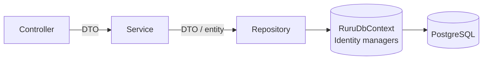
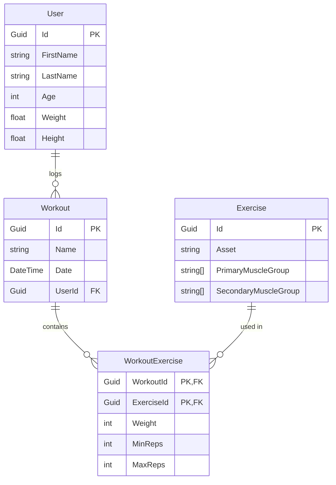

# ruru API

The ASP.NET Core (.NET 10) Web API behind ruru. It handles accounts and authentication, and stores workouts in PostgreSQL through EF Core.

For local setup (user secrets, migrations, running the API), see the [project README](../../README.md#1-run-the-api).

## Architecture at a glance

Each request passes through three layers, and each layer only talks to the one directly below it:



| Layer | Folder | Responsibility |
| --- | --- | --- |
| Controllers | `src/controller/` | HTTP only: bind the request, call a service, turn the outcome into a status code |
| Services | `src/services/` | Business rules, mapping entities to response DTOs, JWT creation |
| Repositories | `src/repositories/` | Data access through `RuruDbContext` or ASP.NET Identity's `UserManager` / `SignInManager` |
| Data | `src/data/`, `src/model/` | EF Core `DbContext` and entity classes |
| Contracts | `src/DTOs/` | Request and response shapes exposed by the API |
| Shared | `src/common/` | Cross-cutting types such as `Result<T>` |

## Design patterns

### Layered architecture (Controller → Service → Repository)

Controllers stay thin. For example, `AuthController.Register` calls `IAuthService.CreateUserAsync` and only decides between `200 OK` and `400 Bad Request`. Rules such as "passwords must match" live in `AuthService`, and the actual user creation lives in `AuthRepository`. This keeps HTTP concerns out of business logic and database code out of services.

### Dependency injection with interface abstractions

Every service and repository has an interface (`IAuthService`, `IWorkoutService`, `IAuthRepository`, `IWorkoutRepository`) and is registered in `Program.cs` with a **scoped** lifetime, so there is one instance per HTTP request:

```csharp
builder.Services.AddScoped<IWorkoutRepository, WorkoutRepository>();
builder.Services.AddScoped<IWorkoutService, WorkoutService>();
```

Classes receive their dependencies through constructor injection and depend only on the interfaces. That means an implementation can be swapped or mocked in tests without touching its callers. Scoped lifetimes match `RuruDbContext`, which EF Core also registers per request.

### Repository pattern

Repositories hide where data comes from:

- **`WorkoutRepository`** wraps `RuruDbContext` queries (`GetByIdAsync`, `GetByUserIdAsync`, `AddAsync`).
- **`AuthRepository`** wraps ASP.NET Identity (`UserManager`, `SignInManager`, `RoleManager`) for creating users, assigning roles and checking passwords. It also handles cleanup: if assigning the role fails, it deletes the user it just created so no user is left without a role.

Services never touch `DbContext` or Identity directly for these operations.

### Unit of Work (via EF Core)

`RuruDbContext` acts as the unit of work: repositories stage changes (for example `AddAsync`), and nothing is written until `SaveChangesAsync()` is called. `IWorkoutRepository` exposes `SaveChangesAsync()` so the **service** decides when a business operation is complete and commits it in one go. You can see this in `WorkoutService.CreateAsync`.

### Result pattern (`Result<T>`)

`src/common/Result.cs` represents an outcome as either a value or a list of error messages, without throwing exceptions:

```csharp
Result<User>.Success(user);
Result<User>.Failure("Role 'User' does not exist.");
Result<User>.Failure(identityResult.Errors.Select(e => e.Description));
```

Repositories and services return `Result<T>` for expected failures (wrong password, duplicate email, locked account) and stay unaware of HTTP. The controller is the single place that maps `Succeeded == false` to an HTTP error. The private constructor and static factory methods ensure a result is always valid: a success always carries a value, and a failure always carries errors.

At the moment the auth flow uses `Result<T>`, but the workout flow doesn't yet.

### DTOs (Data Transfer Objects)

Entities in `src/model/` are never sent over the wire directly. Requests and responses use dedicated classes in `src/DTOs/`, grouped by feature:

- `DTOs/Auth`: `RegisterUserRequestBody`, `SignInRequestBody`, `UserSignInResponseBody`, `UserRole`
- `DTOs/Workouts`: `CreateWorkoutRequest`, `WorkoutResponse`

Services map entities to DTOs by hand (see `WorkoutService`), so internal fields like password hashes, security stamps and navigation properties never leak into API responses.

### Feature-grouped folders

Inside the services, repositories and DTOs folders, code is grouped by feature (`AuthService/`, `WorkoutService/`, `AuthRepository/`, `DTOs/Auth/`, `DTOs/Workouts/`), with each interface next to its implementation. Adding a feature (for example, nutrition) means adding a matching set of folders.

## Data access (EF Core)

- **Code-first:** entity classes in `src/model/` are the source of truth, and migrations in `Migrations/` are generated from them.
- **Configuration:** `RuruDbContext.OnModelCreating` uses the Fluent API for keys, relationships and table names (`User`, `Role`). A few rules use data annotations on the entity instead, such as `[Required]`, `[StringLength]` and `[PrimaryKey]`. `ApplyConfigurationsFromAssembly` is already in place, so any `IEntityTypeConfiguration<T>` classes you add are picked up automatically.
- **Many-to-many with extra data:** `WorkoutExercise` is an explicit join entity between `Workout` and `Exercise`, with a composite key (`ExerciseId`, `WorkoutId`) and extra columns (`Weight`, `MinReps`, `MaxReps`).
- **Delete behaviour:** relationships use `DeleteBehavior.NoAction`, so deleting a parent row never cascades silently.
- **Seeding:** the `User` and `Admin` roles are seeded both by migration (`HasData`) and at startup in `Program.cs`, which creates any role from the `UserRole` enum that's missing.

### Domain model



The editable ERD is in [`docs/rurugileERD.drawio`](../../docs/rurugileERD.drawio).

## Authentication

- **ASP.NET Core Identity** manages users and roles. `User` extends `IdentityUser<Guid>` and `RuruDbContext` extends `IdentityDbContext<User, IdentityRole<Guid>, Guid>`, so every key is a GUID. Password and unique-email rules are configured in `Program.cs`.
- **JWT bearer tokens:** after a successful register or login, `AuthService` creates an HMAC-SHA256 signed token. It contains the user's id (`sub`), email, a unique token id (`jti`), their name, and a claim for each role.
- **Roles:** new users get the `User` role. Role names come from the `UserRole` enum.
- **Protected endpoints:** JWT bearer is the default scheme (registered after `AddIdentity`, which would otherwise make cookies the default). Controllers marked `[Authorize]`, such as `OnboardingController`, read the user id from the token's `sub` claim, never from the request.

## Onboarding and consent

- **`UserProfile`** (one row per user) holds the onboarding answers. Single-choice answers are stored by enum name; multi-choice answers are PostgreSQL text arrays of enum names. The profile is deleted with the user.
- **`UserConsent`** records consent to process health information, which POPIA treats as special personal information. Each row keeps the consent text version and when it was given or withdrawn. Withdrawing consent clears every stored answer.
- **Consent text version:** `OnboardingService.CurrentConsentVersion` must match `CONSENT_VERSION` in the web app's `src/onboarding/consent.ts`. Bump both whenever the wording changes.
- **Validation:** users must be 18 or older. Height, weight and workout length are range-checked, and the required answers are checked when onboarding is completed.

## Configuration

Settings are read through `IConfiguration`. Keep secrets in [.NET user secrets](https://learn.microsoft.com/aspnet/core/security/app-secrets) or the git-ignored `appsettings.Development.json`, never in `appsettings.json`.

| Key | Used for |
| --- | --- |
| `ConnectionStrings:DefaultConnection` | PostgreSQL connection |
| `Api:Key` | JWT signing key |
| `Api:Authority`, `Api:Audience` | JWT issuer and audience |
| `Api:ExpireMinutes` | Token lifetime |
| `Api:ValidIssuers`, `Api:ValidAudiences`, `Api:MetadataAddress` | JWT validation |

## Adding a feature

To add a new feature (for example, meals), follow the existing pattern:

1. Add an entity in `src/model/` with a `DbSet` and any Fluent configuration in `RuruDbContext`.
2. Run `dotnet ef migrations add <Name>`.
3. Add request and response DTOs in `src/DTOs/<Feature>/`.
4. Add `I<Feature>Repository` and its implementation in `src/repositories/`.
5. Add `I<Feature>Service` and its implementation in `src/services/<Feature>Service/`, returning `Result<T>` for expected failures.
6. Register both with `AddScoped` in `Program.cs`.
7. Add a thin controller in `src/controller/`.
